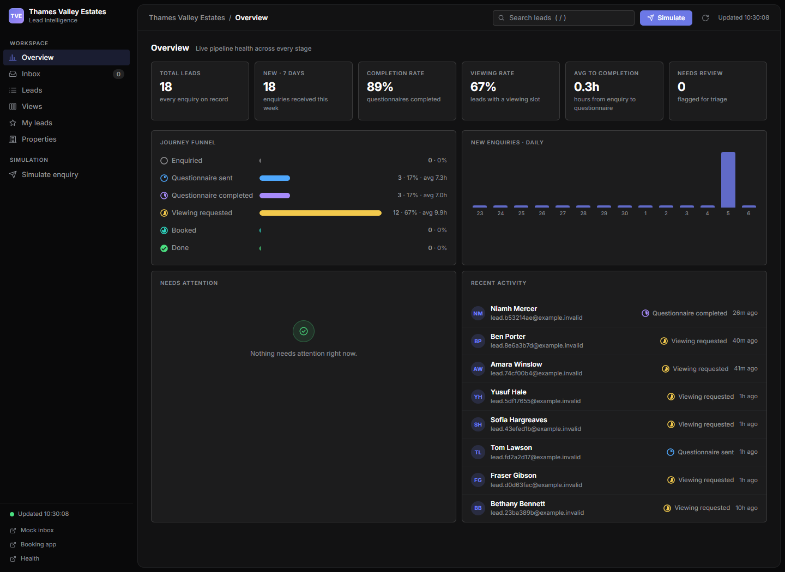

# Questionnaire and Booking

[Repository overview](../../README.md) → **Application guide**

This is the production Questionnaire and Booking application. The dashboard's **Sandbox** mode selects isolated databases, synthetic/test journeys and Mailpit; **Production** selects the existing production stores and configured live mail. Both modes use the same code/frontend. Acquaint properties and appointments remain live read-only inputs in Sandbox.

## Start locally with `SANDBOX=TRUE`

From the repository root, create the one required local environment file:

```powershell
if (-not (Test-Path Apps/Questionnaire-and-Booking/backend/.env)) {
    Copy-Item Apps/Questionnaire-and-Booking/backend/.env.example Apps/Questionnaire-and-Booking/backend/.env
}
```

Keep `sandbox=TRUE` in `Apps/Questionnaire-and-Booking/backend/.env` for a local stack. On the estate server, the persisted Dashboard mode takes precedence; use **Settings → Switch to Sandbox** only after the one-time [sandbox database rollout](backend/docker/SANDBOX.md). `SANDBOX` is also accepted; use one bootstrap spelling rather than conflicting duplicates.

```powershell
Set-Location Apps/Questionnaire-and-Booking
docker compose --env-file backend/.env -f backend/docker/docker-compose.yml up --build -d
```

Compose supplies separate local Postgres defaults for Production and Sandbox. The sandbox service uses its own local account and private network; configure a unique password and sandbox signing key for server use. `backend/.env` is explicitly supplied for Compose interpolation so the frontend proxy uses the same webhook bootstrap secret as the backend. The app-root `.env` can hold optional overrides, but it is not automatically merged; see [environment loading](backend/docker/README.md#environment-loading). Existing volumes retain their initialized accounts.

Open the applications:

| App | URL | Purpose |
|---|---|---|
| Booking | <http://127.0.0.1:3000> | Select a viewing slot |
| Questionnaire | <http://127.0.0.1:3001> | Complete the tokenised questionnaire |
| Lead Intelligence dashboard | <http://127.0.0.1:3002> | Live leads, triage and funnel |
| Credential settings | <http://127.0.0.1:3002/#/settings> | Edit encrypted credential overrides and test connections |
| Function logic health | <http://127.0.0.1:8001/healthz> | Check the API |
| Mock inbox (simulation only) | <http://127.0.0.1:8025> | Inspect simulated email |

### What `SANDBOX=TRUE` changes

- Uses synthetic portal fixtures and local Mailpit (`mock-inbox`) instead of real inbound/outbound mail.
- Stores contacts, enquiries, responses, tokens and settings only in separate sandbox databases. Missing or invalid sandbox storage fails closed; it never falls back to production.
- Reads real Acquaint appointments and the bookable property catalogue (statusId 0 and 1) when valid credentials are present, strictly read-only, to block busy calendar slots and serve the dashboard Properties tab. It never writes to Acquaint.
- Stores viewing requests locally and records the contact stage as `viewing_requested`.
- Sends every sandbox message to Mailpit, never production SMTP. The Agent is paused because its n8n tools use production data.

On an initialized server, the dashboard mode selects the full data path. Shared Acquaint and webhook settings are read-only while Sandbox is active; sandbox mail/token settings use their namespaced store and environment. The bootstrap flag is for local start/configuration, not a production isolation substitute. Acquaint GET reads use shared control credentials; CRM mutations remain blocked.

Settings connection tests are explicit probes of the supplied/current endpoints. They can contact a configured real Acquaint, IMAP or SMTP server even while `sandbox=TRUE`; the worker's simulation routing does not redirect these tests.

### Start in production mode

Set `sandbox=FALSE` in `backend/.env` and supply the IMAP and SMTP connection details plus Acquaint credentials. The worker uses real IMAP and SMTP automatically: no separate enable or permission flags are required. Missing production mail credentials cause a configuration error instead of silently disabling delivery. Never commit the real values. The current Acquaint adapter remains read-only in production too; switching modes does not implement CRM appointment writes.

After editing `backend/.env`, use the same Compose command with `up -d --force-recreate` to load the new environment. A plain `restart` does not reload changed environment values. Settings-panel credential overrides are dynamic and normally need no recreation. Use `up --build -d` after source changes. All commands below are relative to the application directory unless explicitly noted otherwise.

## Credential settings

The **Settings** page in the lower sidebar at <http://127.0.0.1:3002/#/settings> manages credentials in a dedicated encrypted Postgres store. The existing environment file remains the bootstrap configuration; values are not copied into the database automatically.

### Enable the vault

From the application directory, install the backend dependencies for the provisioning helper, provision the master key, and recreate the application services:

```powershell
python -m pip install -r backend/requirements.txt
python Tools/provision-settings.py
docker compose --env-file backend/.env -f backend/docker/docker-compose.yml up --build -d
```

The helper requires an existing `backend/.env`. It generates a Fernet key when the master-key assignment is missing, empty or a template placeholder; preserves an existing valid key; adds the local webhook bootstrap secret only when its assignment is missing; and sets the settings TTL to five seconds. It does not print credential values. See [the provisioning tool](Tools/README.md#credential-vault-provisioning) for exact rerun behaviour.

The generated `TVE_SETTINGS_MASTER_KEY` is loaded only by Function Logic and the mail worker. The frontend does not load the full backend environment. Keep the key with the backup of `tve-pg-settings-data`, because a new key cannot decrypt existing overrides.

### Use the panel

| Action/status | Behaviour |
|---|---|
| **Database override / Environment / Not configured** | Configuration presence/source for that field; not proof that the provider accepts it |
| **Details** | Expand to inspect the exact environment key, visible effective value and latest database update |
| **Save** | Validate and encrypt one field; replace/create its database override |
| **Clear** | Delete one override; return to the environment fallback or unset |
| **Test connection** | Probe current values plus changed, unsaved inputs; do not store candidates |
| **Refresh settings** | Reload metadata and vault status while retaining unsaved input |
| **Vault locked** | Master key is missing/invalid; the panel disables editing, Save and Clear |

The groups are **Acquaint**, **IMAP**, **SMTP** and **Security**. (The **Agent** group is displayed separately on the Settings page and is not connection-testable.) Secrets are never prefilled or returned as plaintext. API metadata masks expose at most the last four characters, with no suffix for short values; the compact panel displays configuration status without rendering the mask. Non-secret connection fields are visible. Save appears for a non-empty changed value, and Clear appears for a database override. Save operates per field, so a group with several changed inputs is not an atomic multi-field update. Use Test connection to check the complete candidate configuration before saving its fields.

Resolution is **database override → process environment → unset**, followed by any integration-specific defaults. An existing encrypted row that cannot be decrypted fails closed rather than silently reverting to the environment. Editing `.env` does not replace a database override; use Clear when the intended source is the environment again.

### When changes take effect

API Save/Clear invalidates the corresponding cache entry in Function Logic immediately. Other Python processes use a default five-second TTL for cached overrides. Mail changes apply to subsequent sends, and IMAP credentials are refreshed on each production poll. A credential edit does not replay a failed send, interrupt an in-flight request or change the integration mode.

Acquaint credential changes replace cached authenticated clients and invalidate the dashboard's property list for the next load. Incomplete sandbox credentials select fixtures; complete credentials that fail authentication produce an integration error. SMTP remains routed to Mailpit in sandbox mode, with the edited sender on subsequent messages. IMAP host/port/username/mailbox changes select persistent per-identity checkpoints; a new identity baselines current UIDNEXT-1 without historic intake, while returning to a known identity resumes its checkpoint. Password edits retain the checkpoint.

### Key changes and scope

Both Save and Clear require confirmation for token signing and webhook authentication keys. Changing `TVE_TOKEN_KEY` makes links signed by another key fail validation; fresh invitation/booking links must be issued. Webhook rotation accepts both the current override and backend bootstrap secret during transition. To retire the old bootstrap value, update `TVE_WEBHOOK_SECRET` in `backend/.env` and recreate both Function Logic and the frontend with `--env-file backend/.env`.

The mode card switches environments only after verifying sandbox storage. **Load test data** adds six synthetic examples without resetting existing test journeys. Acquaint/webhook settings are read-only in Sandbox; n8n Agent tools are paused there. The panel does not edit public URLs, tuning values, master key, DB DSNs, Postgres accounts or Compose ports. See [backend dynamic credential settings](backend/README.md#dynamic-credential-settings) and [dashboard Settings](frontend/dashboard/README.md#settings--workspace-credentials).

## Contact journey

1. Run `python Tools/run_sandbox_e2e.py` to exercise a synthetic enquiry through the local mock inbox when `SANDBOX=TRUE`.
2. The worker parses the message, upserts the contact and enquiry, and sends the questionnaire invitation.
3. The Lead Intelligence dashboard shows the contact’s stage: `enquiried` → `Questionnaire_sent` → `questionnaire_completed` → `booking_link_sent` → `viewing_requested` → `booked` → `done`. Both automatic and manual booking emails advance to **Booking link sent** only after SMTP accepts delivery. Resending never moves a requested or booked viewing backwards. Existing token rows alone are not proof of email delivery and are not backfilled into this stage.
4. Submit the questionnaire. The success screen asks the applicant to check their inbox and spam/junk folder. The booking link is sent through the mode-selected SMTP adapter and is also available from the Lead Intelligence dashboard. A viewing-request acknowledgement is sent after the request is saved.
5. For a contact with a linked property, open the dashboard's booking link and request a viewing. Reopening the link displays an existing viewing request. `booked` and `done` are supported stages but are not automatically advanced by the local request flow.

## Lead Intelligence dashboard

Open <http://127.0.0.1:3002/#/overview>. The eight-page dashboard uses an authenticated backend proxy: lead data is stitched from the four journey databases, and credential metadata comes from the fifth settings database.

- **Overview:** lead totals, completion/viewing rates, current-stage funnel, daily enquiries and recent activity.
- **Inbox:** missing-property, stalled, expired-link and unresponsive leads, with triage actions.
- **Leads:** search, stage filters and sorting; click a row for answers, parsed/raw enquiry, score reasons and applicant links.
- **Views:** seven saved segments, including High intent and Awaiting booking.
- **My leads:** contacts starred in this browser's local storage.
- **Properties:** selectable properties grouped by town, with lead counts and filtered lead links.
- **Agent:** Meesix chat routed through the authenticated backend to n8n, with an allowlisted local-model selector and tool-use summaries.
- **Settings:** encrypted, write-only credential editing and connection tests. See [vault setup and key rotation](backend/README.md#dynamic-credential-settings).

**Assign property** updates the contact association; **Resend questionnaire** refreshes the questionnaire token expiry and sends mail through the mode-selected adapter. **Send booking** is an authenticated staff override: it issues or refreshes a booking link regardless of score or questionnaire completion and records **Booking link sent** after delivery, without fabricating answers. It requires an email address and assigned property. The booking-purpose token authorizes availability and submission; automatic booking-link issuance still requires a qualifying questionnaire score. Invitation resending remains limited to contacts awaiting a questionnaire.

Viewing approval bounds Acquaint calls and returns the saved decision even if the subsequent lead/catalogue refresh fails. An appointment creation timeout leaves the lead pending and asks staff to check Acquaint before retrying, because the remote write's outcome may be unknown.

Acquaint's Viewing type requires a contact attendee. Approval finds a unique exact email match in Acquaint (or creates a lettings applicant if none exists) and supplies that CRM id in `attendees`. Ambiguous contacts and validation/permission rejections return actionable application errors. Sandbox simulates applicant and appointment creation.



The [dashboard guide](frontend/dashboard/README.md#screenshot-walkthrough) includes screenshots of the six lead-management pages, lead details and the property-assignment dialog, plus written Agent/Settings walkthroughs and scoring/flag explanations. To regenerate the existing images, follow [Tools: dashboard screenshots](Tools/README.md#dashboard-screenshots-and-browser-smoke-check).

## Databases

Production and Sandbox use independent stores. Sandbox databases are `sandbox_contacts`,
`sandbox_enquiries`, `sandbox_responses`, `sandbox_tokens` and `sandbox_settings` on the
separately-accounted/networked `pg-sandbox` service. No applicant records are copied
between environments. See [sandbox operations and first server rollout](backend/docker/SANDBOX.md).

Each production data table is hosted in its own Postgres container/database:

| Container | Table | Stores |
|---|---|---|
| `pg-contacts` | `contacts` | Identity, journey status and viewing fields |
| `pg-enquiries` | `enquiries` | Raw enquiry body and parsed fields |
| `pg-responses` | `questionnaire_responses` | Questionnaire answers and completion time |
| `pg-tokens` | `tokens` | Questionnaire/booking links, expiry and use time |
| `pg-settings` | `settings` | Encrypted credential overrides and update metadata |

`sandbox=TRUE` or the persisted Dashboard override selects all five sandbox stores;
`pg-sandbox` persists them on its own volume. Production uses the existing five stores.

Processed incoming simulation messages are deleted from Mailpit; outgoing invitation messages remain available in the mock inbox. A unique contact email keeps one contact record per person, but it is not a durable per-message deduplication ledger. There are no separate inbound, runs, events, viewings or followups database containers.

## Current implementation limits

- Acquaint reads remain live in both modes. Sandbox simulates applicant and appointment writes; Production approval may create a lettings applicant when no exact email match exists, then creates the Viewing appointment with that CRM contact as an attendee. Other CRM mutations remain blocked.
- The local Compose file supplies development webhook-auth and database defaults and always starts `mock-inbox`, even though only simulation mode uses it.
- Production IMAP replay state lives in the isolated `tve-imap-checkpoint-data` volume: first connection/new UIDVALIDITY skips history, completed UIDs survive restarts, and hashed recent-message dedupe is bounded to 8,192 keys. Intake/checkpoint commits are separate (at-least-once retries); this is not an exactly-once mail-delivery ledger. See [backend replay behaviour](backend/README.md#dynamic-runtime-behaviour).
- Intake stores a uniquely matched property association on the contact. Missing/ambiguous property matches do not receive an automatic invitation.
- Contact-bound tokens use the persisted questionnaire → booking link → viewing-request journey in both modes. Production uses real catalogue/appointment reads and configured SMTP; `viewing_requested` is a request awaiting staff confirmation, not a CRM appointment.
- Verified legacy signed guest forms and tokenless authenticated submissions retain legacy persistence/acknowledgements. They have not been migrated to the contact-driven journey and do not provide the same persisted viewing-request/dashboard tracking.
- Booking-link and viewing-acknowledgement SMTP delivery is best-effort after persistence. There is no durable delivery outbox/retry for these messages; an SMTP failure can leave a saved request without a delivered email.
- End-to-end verification now uses the contact-driven model. See [Tools](Tools/README.md#end-to-end-scripts) for setup; browser scripts need a fresh fixture without a previously saved viewing.

## Automatic estate-server deployment

The repository's `deploy-tve.yml` waits for successful **Application CI** on a trusted
`main` push, then deploys that exact SHA. The entire frontend runtime tree—including
dashboard assets, HTML, styles, JavaScript, proxy and Docker files—is covered, as are
backend code/dependencies/build files and fixtures. Frontend-only changes rebuild
`web-frontend`; backend-only changes rebuild Function Logic and IMAP intake; shared
Compose changes select all three apps. Markdown/docs and deployment-script changes
are copied and smoke-checked without restarting applications.

After one-time sandbox infrastructure provisioning, automatic releases preserve the
existing runtime `.env` files, keys and volumes; the new sandbox volume is operator-
provisioned and never auto-created. The estate server uses API `5000`, booking/questionnaire
`13000`/`13001` and dashboard `3002` on loopback. Vercel and n8n Agent deployments
are separate. See [automatic deployment operations](backend/docker/DEPLOYMENT.md)
for the exact host contract, interpolation precedence, lock, recovery and explicit
schema-migration requirements.

## Checks

From `backend/`:

```powershell
python -m pytest -q
python -m compileall -q app tests
```

The settings-focused subset is:

```powershell
python -m pytest -q tests/test_settings_store.py tests/test_settings_api.py tests/test_dynamic_credentials.py
```

These tests cover encryption/masking, fallback and cache behaviour, validation, authentication/rotation, candidate probes, dynamic integration reads and link invalidation. They use fake databases and provider transports; live connection results are checked separately through Settings.

From the app root, the Mailpit viewer and offline deployment tests are:

```powershell
python -m pytest -q Tools/test_live_log_viewer.py
python -m pytest -q Tools/test_deploy_tve.py
```

Compose operations and service names are documented in [`backend/docker/README.md`](backend/docker/README.md). Never use `down --volumes` for a routine restart; it deletes the database records and mock inbox.

Optional local event viewer (not a Compose service):

```powershell
python Tools/live-log-viewer.py
```

It listens on <http://127.0.0.1:3003>. Fixtures and their original checksum provenance live under [`Tools/`](Tools/README.md); historical source paths in the manifest intentionally refer to the original repository commit.

## Where to go next

| Need | Guide |
|---|---|
| Start, stop or recreate containers | [Docker operations](backend/docker/README.md) |
| Provision the vault, rotate keys or recover stored credentials | [Dynamic credential settings](backend/README.md#dynamic-credential-settings) |
| Understand backend configuration and mail processing | [Backend](backend/README.md) |
| Find routes and service code | [Function Logic package](backend/app/README.md) |
| Understand the web server and proxy | [Frontend](frontend/README.md) |
| Use lead triage, scoring and saved views | [Lead Intelligence dashboard](frontend/dashboard/README.md) |
| Follow the viewing flow | [Booking page](frontend/booking/README.md) |
| Follow the questionnaire flow | [Questionnaire page](frontend/questionnaire/README.md) |
| Use fixtures, viewer and regression tools | [Tools](Tools/README.md) |

Configuration templates: [app settings](backend/.env.example) and [optional Compose overrides](.env.example). Bootstrap secrets belong in ignored environment files; panel overrides are persisted encrypted in `pg-settings`.
