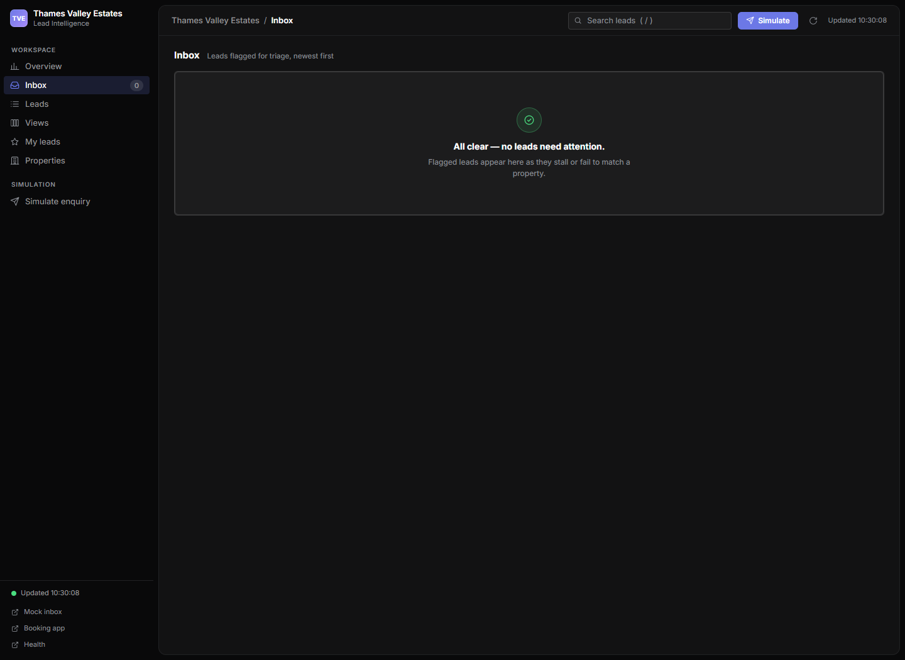
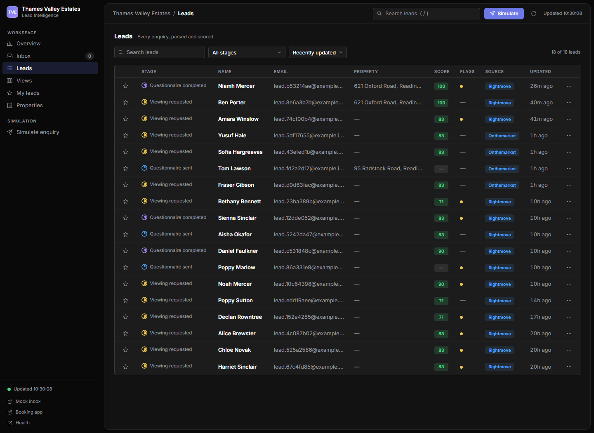
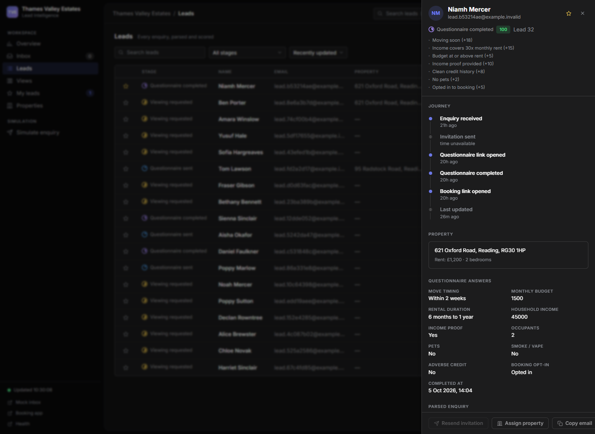
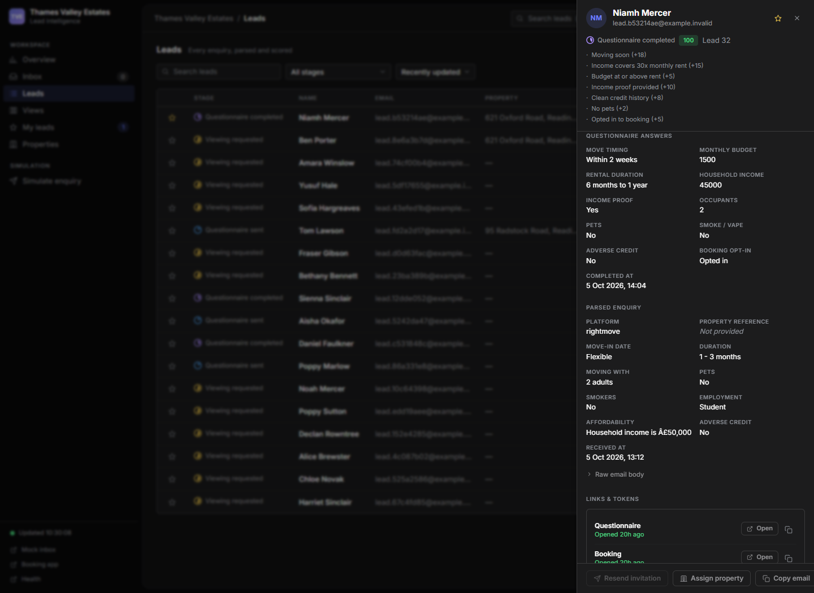
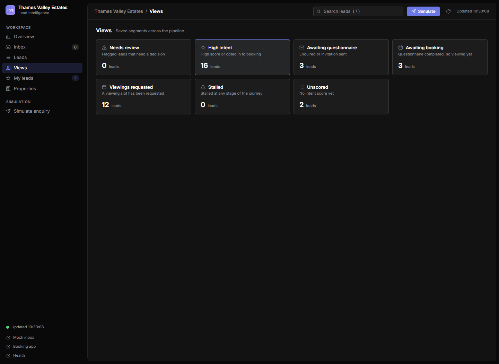
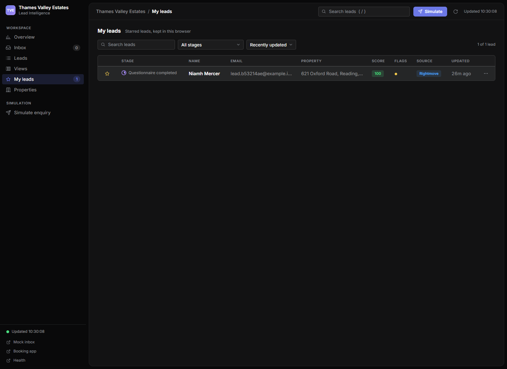
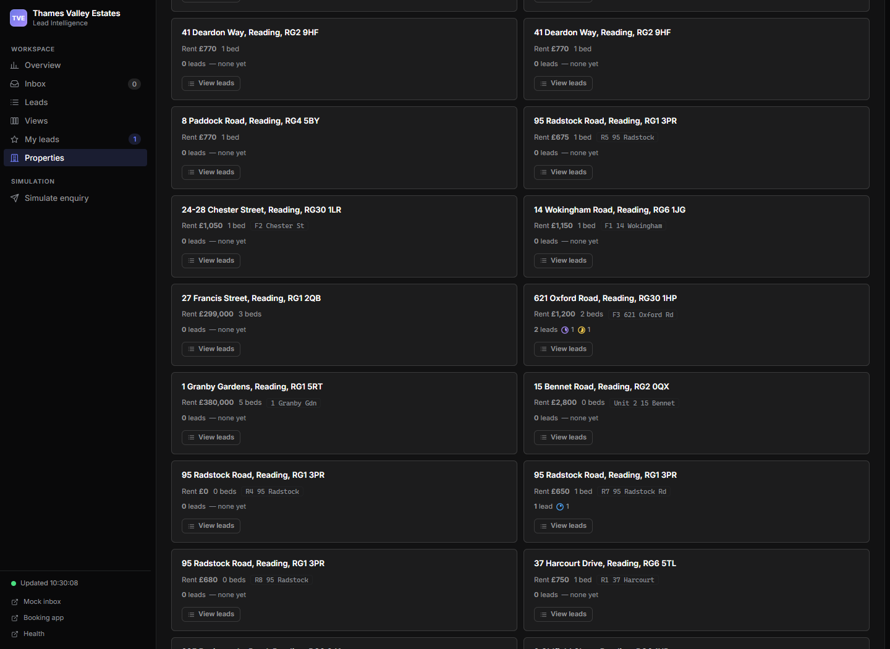
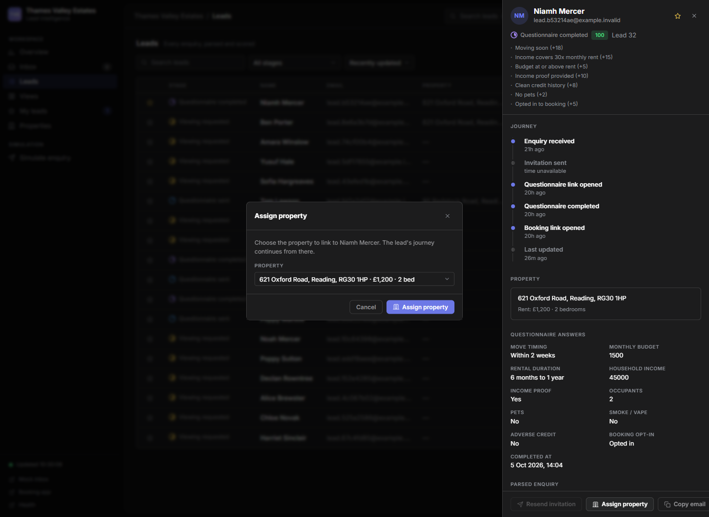

# Lead Intelligence Dashboard (localhost:3002)

[Repository overview](../../../../README.md) → [Application guide](../../README.md) → [Frontend](../README.md) → **Dashboard**

This folder is the **dashboard app** served on port **3002** by `frontend/serve-local.js`
(URL prefix `/sandbox`). It is a real, fully functional single-page application — three
static files, no frameworks, no build step, no external network dependencies (self-hosted
Inter Variable font, all icons inline SVG) — that replaces the retired static Linear snapshot in
[`../dashboard-snapshot/`](../dashboard-snapshot/README.md) (kept as a design reference only).
It also supersedes the older [`../dashboard-original/`](../dashboard-original/) prototype.

Open <http://127.0.0.1:3002/#/overview>. The images below were captured from the running app using synthetic contacts, not a static design mock-up.

## Screenshot walkthrough

### Overview — pipeline health

The cards show total leads, new leads in the last seven days, questionnaire completion and viewing rates, average hours to completion and the review count. The funnel shows **current occupancy** of each stage, its share of all contacts and time since the contact's last update; it is not a historical stage-transition log. The daily chart covers the last fourteen UTC dates. Recent activity lists the most recently updated contacts.

The Overview **Needs review** KPI counts missing-property, expired-link and unresponsive contacts. Inbox and the Needs review saved view also include stalled invitations/questionnaires.


### Inbox — triage queue

Inbox collects leads with a missing property, stalled invitation/questionnaire, expired questionnaire link or an unresponsive early-stage journey. Click **View lead** to investigate, **Assign property** to link the correct listing or **Resend invitation** while the questionnaire is still outstanding.



### Leads — searchable working list

Search matches name, email, property address, source platform and flag names. Combine it with a stage filter or saved-view/property filter; sort by recent update, score or oldest enquiry. Hover score chips for the calculation reasons and flag dots for their meaning. Row menus open applicant links and expose triage/copy actions.

The **stage column** shows Linear-style SVG progress-ring status icons that fill progressively as a contact advances through the journey — an empty ring for Enquiried, an increasing arc for Questionnaire sent / completed / Viewing requested / Booked, and a full circle with a checkmark cutout for Done. Each icon keeps the dashboard's own stage colour (grey, blue, violet, amber, teal, green) rather than Linear's palette.



### Lead details — one stitched contact record

Click a row to open the detail drawer. Its header explains the score; the body brings together journey milestones, property details, questionnaire answers, parsed enquiry, expandable raw email, link expiry/use metadata and flags. Existing unexpired applicant links can be opened or copied from **Links & tokens**. Dates are displayed in Europe/London.





### Views — reusable segments

Seven built-in views filter the loaded lead list: Needs review, High intent, Awaiting questionnaire, Awaiting booking, Viewings requested, Stalled and Unscored. **High intent** means a high score or booking opt-in; **Viewings requested** means a stored viewing slot. Counts update with the lead poll.



### My leads — a personal shortlist

Click a star in the Leads table or detail drawer to add/remove a contact here. Stars persist in this browser's `localStorage`; they are not staff ownership assignments and do not sync between devices.



### Properties — listing-centred pipelines

The page groups selectable properties by town, showing rent, bedrooms and associated lead/stage counts. **View leads** opens a property-filtered lead table. The catalogue comes from the booking properties endpoint; it serves live Acquaint reads (statusId 0 and 1) whenever valid credentials are configured — including in simulation — and fixtures otherwise.

Lead models keep the stored CRM `property_id` and expose a separate `catalogue_property_id`, so simulation fixture IDs correctly match property cards, filters and assignment preselection.



### Agent — ask the live data

The sidebar's second section is **YOUR TEAMS** and holds the **Agent** entry. **Settings** lives
in the lower sidebar section with the connection status.

The button beside the workspace name collapses the sidebar into a 56 px icon rail: page icons,
count dots and the mode dot stay, while labels move into hover tooltips and the workspace name
is hidden. The choice persists in this browser's `localStorage` (`tve-sidebar-collapsed`), like
the starred leads.

The collapse animates rather than snapping. Nothing inside changes position instantly: the copy
and the sections shrink with the rail, the avatar and mode badge have explicit sizes in both
states so they can interpolate, labels fade out before the panel edge reaches them and fade back
in only once the row is wide enough to show them whole, and the count pill morphs into the rail
dot. Because the rail travels further than anything else in the app, it uses its own
`--rail-speed` (280 ms ease-out) instead of the shared `--speed`.

`#/agent` opens the Meesix-branded compact chat. Messages go same-origin to the authenticated
dashboard backend, which proxies them to n8n using the encrypted Agent webhook URL and a dedicated
write-only `TVE_AGENT_N8N_WEBHOOK_SECRET`. Configure that secret to match the n8n Agent Webhook
credential; it is separate from dashboard `TVE_WEBHOOK_SECRET`. The browser never receives credentials or calls n8n directly. The selector
offers only local models: `qwen3.5:27b` (default/best), `qwen3:14b` (fast), and
`qwen3.6:latest` (experimental); the preference is saved in this browser. Replies show model and
tool-use summaries. If n8n is unavailable, the chat displays a helpful Settings connection message.

| Ask about | Answer |
|---|---|
| needs attention / review / flagged | Leads carrying a review flag (`unmatched_property`, `stalled_questionnaire`, `stalled_enquiried`, `expired_questionnaire_token`, `unresponsive`), with a count for each flag |
| high intent / best leads | Leads with a `high` score band or a booking opt-in, sorted by score |
| stalled | Leads on a `stalled_*` flag, longest waiting first, with how long since the last update |
| funnel / pipeline / summary | The six journey stages with counts and the pipeline total (`GET /sandbox/api/funnel`) |
| metrics / how many / KPIs | Total leads, new 7-day leads, completion and viewing rates, upcoming viewings and high-intent count (`GET /sandbox/api/metrics`) |
| a property address or street | Loaded leads whose `property_address` matches the words typed |

The global lead search is hidden on this view. Press `Enter` to send. The selected model is stored
under `tve-agent-model` in localStorage; credentials and chat auth are never stored there.

The n8n Agent can call the read-only property contacts tool at
`GET /dashboard/properties/{property_id}/contacts`. It reads tenancy links and concise contact
details through the allowlisted Acquaint GET client, deduplicates contacts, and makes no CRM writes.

### Settings — workspace credentials

Sandbox has separate contacts, enquiries, responses, tokens and settings databases.
**Load test data** in Settings adds six synthetic examples for frontend and full-journey
testing while preserving existing test journeys. Properties and appointments remain
live Acquaint read-only reads; outgoing email stays in Mailpit. Shared Acquaint/webhook
settings are read-only in Sandbox, and n8n Agent tools are paused because they use
production data. See [sandbox operation and first rollout](../../backend/docker/SANDBOX.md).

Open **Settings** in the lower sidebar (`#/settings`). The top **Sandbox / Production** card
shows the current mode and source and offers a confirmed switch. A mode badge stays visible
in the sidebar. Sandbox mode routes mail intake and delivery through the always-running Mailpit
container; Production resumes live IMAP and production SMTP. The worker observes a change on
its next poll (up to the configured production poll interval). Sandbox test messages use
the dedicated sandbox databases; Production uses the existing live stores. The app rejects
stale mode-bound requests and reloads after a switch. Browser stars are stored separately
by environment.

Compact credential cards group settings into Acquaint, IMAP, SMTP, Security and Agent. Each field shows whether it is configured and its source
(**database**, **environment** or **unset**). Expand **Details** to see the environment key,
effective non-secret value and last database update (Europe/London) when available. The page
reads metadata on opening and through **Refresh settings**; it is not a continuously polled
credential form.

#### Groups and field visibility

| Card | Visible fields | Write-only fields |
|---|---|---|
| Acquaint | Base HTTPS origin | API key, site prefix |
| IMAP | Host, port, username, mailbox | Password |
| SMTP | Host, port, username, From address | Password |
| Security | None | Token signing key, webhook auth header |
| Agent | Webhook URL, default local model | n8n webhook authentication secret |
| Sandbox / Production | Current runtime mode and source | — |

Expand **Details** for the exact environment key so it can be matched to the backend template. **Database override** means the saved override takes priority, **Environment** means the running backend's startup value is used, and **Not configured** means neither source supplies a configured value. Configuration status does not mean authentication has passed.

Secret values are never displayed. Secret inputs start empty and accept replacement values only; Details reports whether a secret is configured without revealing it. Environment fields have no database update time; database-backed fields show the latest row timestamp/channel, not a complete edit history.

#### Edit, test and save

1. Open the relevant card and enter replacement values. Visible inputs start with their current values; password inputs always start empty.
2. Choose **Test connection** to check the complete candidate configuration, when available. Only changed inputs in that card are sent as candidates; untouched fields resolve from current settings/environment. A blank secret input means “use the existing secret” unless it is being submitted as a changed candidate.
3. Review the pass/fail result. A successful test does not save candidates, and a failed test does not replace the configured credentials.
4. Choose **Save** beside each field you intend to persist. Save applies one field at a time; it is not a transaction for the whole card.
5. After a successful write, the row receives refreshed source/status/update metadata. A secret input is emptied; a visible input shows its saved value.

Save appears only for a non-empty changed value and is enabled only for an unlocked vault when no operation is in progress. It validates the field before storing it. All writes require strings, reject empty/template-placeholder/control-character input and enforce key-specific formats. Acquaint base must be an HTTPS origin, site prefix must match the allowed characters, ports must be integers from 1 to 65,535, and From must be a plain email address. See the [complete key reference](../../backend/README.md#editable-credential-reference).

Field validation and connection failures display sanitized messages, not raw submitted values or provider exceptions. Failed writes retain the unsaved input for correction. During an in-page operation, controls are temporarily disabled so a second operation cannot be submitted concurrently from this page.

#### Clear an override

**Clear** appears only for a database-backed field and is enabled in an unlocked vault when no operation is in progress. It deletes that field's override and restores the running backend's environment value, or leaves it unset. It does not edit `.env`, clear provider-side credentials, disable an environment-backed integration or undo to the previous database value. Environment-backed fields therefore have no Clear action.

For example, saving an SMTP sender makes that row **Database override**. Clearing it makes the row **Environment** again if `TVE_ENQUIRY_FROM` is configured in the backend startup environment. Typing an empty value is not an alternative to Clear.

#### What connection tests establish

| Card | Test | A pass does not establish |
|---|---|---|
| Acquaint | Authentication plus one read-only property-list page | CRM mutation support or access to every endpoint |
| IMAP | TLS login and read-only mailbox selection | That intake has processed messages or that the worker is in production mode |
| SMTP | Server connection and EHLO/HELO; implicit TLS on port 465 | Successful login, STARTTLS negotiation, sender acceptance or mail delivery |

Tests do not persist candidates, modify selected mailbox messages or send mail. There is no Security test button. A probe uses five-second request/socket timeouts and a 12-second async deadline; results show a sanitized passed/failed message. Missing/invalid current values can cause validation failure before a connection is attempted.

Explicit tests contact the current/candidate endpoint even in sandbox mode. The worker still bypasses real IMAP intake and routes outgoing mail to Mailpit. To test Mailpit SMTP from the Compose backend, temporarily enter candidate host `mock-inbox` and port `1025`, choose Test connection, then discard/restore those unsaved inputs if production settings should remain active.

#### Refresh, unsaved input and runtime updates

**Refresh settings** reloads source/status/update metadata and vault status without discarding changed inputs. Lead polling never rebuilds the credential inputs. Candidates live only in this page's input elements and request payloads; they are never written to `localStorage` or `sessionStorage`.

Leaving Settings clears inputs and aborts pending browser requests. It does not undo a write already received by the backend; reopen or refresh Settings to check the persisted result if navigation occurred during Save/Clear. Successful writes discard the saved candidate.

Save/Clear invalidates the backend's local settings cache immediately. Other Python processes refresh cached overrides after a default five-second TTL and use them at their next operation/poll. Existing network requests/sends are not restarted. Acquaint writes also invalidate the dashboard's property list, so the next Properties visit reloads it. Complete but invalid Acquaint credentials cause a genuine integration error rather than silently displaying fixtures; clearing back to valid environment credentials restores access.

The selected environment's SMTP sender applies to subsequent messages. Sandbox defaults to `lettings@sandbox.invalid` and never borrows the production sender. IMAP connection edits made in Production apply at the next production poll, selecting persistent per-identity checkpoints for host/port/username/mailbox changes. New identities baseline without fetching history; returning identities resume their saved UID. Credential edits do not change the sandbox mode or automatically retry a previous delivery failure.

#### Security-key confirmations

Save and Clear both require confirmation for `TVE_TOKEN_KEY` and `TVE_WEBHOOK_SECRET`. Cancel, Escape or closing the dialog leaves the persisted setting untouched.

- **Token signing key:** a different effective key rejects links signed with the previous key. Applicants need fresh links through the appropriate issuance/resend flow. Changing the key does not delete their contact, questionnaire or viewing records. Legacy opaque-link compatibility and rollback behaviour are detailed in [token rotation](../../backend/README.md#token-signing-key-rotation).
- **Webhook auth header:** the backend accepts the vault replacement and its startup bootstrap value during transition, so the current proxy keeps working. To retire the old bootstrap value, set the new `TVE_WEBHOOK_SECRET` in `backend/.env` and recreate both `app-function-logic` and `web-frontend` with Compose `--env-file backend/.env`. A plain restart does not reload the environment. See [webhook rotation](../../backend/README.md#webhook-authentication-rotation).

The same considerations apply when Clear restores a different environment key. Clear can change the effective key just as Save can.

#### Locked/unavailable vault

**Vault locked** disables editing, Save and Clear. When the database is reachable, source/status/update metadata remains readable even if stored values cannot be decrypted; environment-backed values remain available. Connection tests stay enabled but can fail if required values are locked, unreadable or invalid.

Unlocking requires a valid `TVE_SETTINGS_MASTER_KEY` in the Python service environments and recreation after changes. A syntactically valid replacement key displays **Vault unlocked** but cannot decrypt rows encrypted under another key. A 503 write failure also puts the page into an unavailable/locked state until refreshed. Use **Refresh settings** after correcting the backend. See [vault setup/recovery](../../backend/README.md#locked-vault-recovery-and-backups).

The operational mode is persisted in the encrypted Settings store and can be changed without restarting containers. The other non-credential settings (tuning/public URL variables, DB DSNs, Postgres accounts, Compose ports, master key and cache TTL) remain configured at startup. Settings responses use `no-store`, and the proxy sanitizes non-success error details. The panel does not expose historical values or a master-key re-encryption action.

### Assign property

**Assign property** writes the selected association to the contact and returns its refreshed read model. It accepts only selectable catalogue properties and rejects contacts that already have a viewing. It does not automatically send an invitation; use **Resend invitation** for eligible early-stage contacts afterward.



To refresh the dashboard screenshots and run the browser smoke check, see [Tools](../../Tools/README.md#dashboard-screenshots-and-browser-smoke-check).

## Scores and attention flags

Scores are deterministic and computed on demand from stored questionnaire answers and the linked property's monthly rent. A missing questionnaire is **unscored**. Otherwise the calculation starts at **40**, applies the following weights and clamps to **0–100**:

| Answer/component | Points |
|---|---|
| Move within 1 / 2 / 3 / 4 weeks | +25 / +18 / +12 / +6 |
| Annual household income at least / below 30× monthly rent | +15 / −10 |
| Monthly budget at least / below rent | +5 / −5 |
| Income proof Yes / No | +10 / −15 |
| Adverse credit No / settled / active | +8 / −10 / −20 |
| Pets No / other response | +2 / −5 |
| Smoke or vape Yes | −5 |
| Booking opt-in / opt-out | +5 / −10 |

Income and budget components are skipped when their value or the rent is unknown. Bands are **high ≥70**, **medium 40–69**, **low <40**; the drawer and score tooltip show the reasons actually applied.

Attention flags include:

- **No property:** a portal enquiry/reference exists but the contact has no property association (excluding booked/done).
- **Invitation unsent:** `enquiried`, last updated over 24 hours ago.
- **Stalled questionnaire:** `Questionnaire_sent`, last updated over three days ago.
- **Expired link:** an unused questionnaire token expired before completion.
- **Unresponsive:** `enquiried` or `Questionnaire_sent`, created over seven days ago.
- Budget below rent, income below the 30× monthly-rent threshold, declared adverse credit, no income proof and booking opt-out.

**Resend invitation** is limited to `enquiried`/`Questionnaire_sent` contacts with an email. It refreshes the existing questionnaire token's expiry to the configured token lifetime (`TVE_TOKEN_TTL_DAYS`, default 365 days), clears consumption, and sends through the mode-selected SMTP adapter. An `enquiried` contact advances to `Questionnaire_sent` only after delivery succeeds; mail failures return an error.

## Refresh and data scope

The backend list returns the **200 most recently updated contacts**. Tables, saved-view counts and property counts use that loaded list; Overview KPIs and funnel use all contacts. Details are loaded separately when a drawer opens. The UI retains the last successful data on poll failure and reports connection/API errors; those retained values may be stale. A refresh button retries immediately, and individual action failures appear as toasts or dialog errors. The Agent panel reuses the same funnel and metrics snapshots, fetching them on demand when the view is opened or a message needs them.

## Pages (hash routes)

| Route | Page | What it shows |
|---|---|---|
| `#/overview` | Overview | KPI cards, journey funnel, daily new-enquiries chart, needs-attention list, recent activity |
| `#/inbox` | Inbox (triage) | Leads flagged for review (newest first) with inline **Assign property** / **Resend invitation** / **View lead** actions |
| `#/leads` | Leads | Full table: star, stage, name, email, property, score chip, flag dots, source, updated; search, stage filter, sort, row menu |
| `#/views` | Views | Saved segments (Needs review, High intent, Awaiting questionnaire, Awaiting booking, Viewings requested, Stalled, Unscored) with live counts; clicking opens `#/leads?view=<id>` |
| `#/myleads` | My leads | Starred leads, persisted in `localStorage` under the key `tve-starred` |
| `#/properties` | Properties | Bookable properties (grouped by town) with client-side lead counts and per-stage mini counts; clicking opens `#/leads?property=<id>` |
| `#/agent` | Agent | Minimal Meesix-branded search prompt that answers questions about loaded leads, funnel and metrics; lead answers render as chips that open the lead drawer |
| `#/settings` | Settings | Mode switch and sandbox test-data loader; grouped credential metadata, write-only secrets, per-field Save/Clear, connection tests and rotation confirmations |

`#/leads` accepts query parameters: `?view=<segment-id>` and `?property=<property-id>`.
Legacy snapshot URLs such as `/views.html`, `/issues.html`, `/inbox.html`, `/home.html`,
`/my-issues.html` are redirected by `serve-local.js` to this SPA's `index.html`, so an
old open tab lands in the new app.

A lead detail **drawer** (360 view) opens from any row: journey timeline, property card,
questionnaire answers, parsed enquiry + raw email body, tokens & links, flags, and the
**Resend invitation** / **Assign property** / **Copy email** actions.

## API mapping (UI → proxy → backend)

Every network call goes through the same-origin helper `api(path)` calling
`/sandbox/api/<path>`; `serve-local.js` adds the `X-TVE-Auth` header and proxies to the
backend (`app-function-logic`, port 8001 locally).

| UI feature | Proxy route | Backend target |
|---|---|---|
| Leads poll (every 5 s), tables, badges, drawer base data | `GET /sandbox/api/leads` | `GET /dashboard/leads` |
| Lead 360 drawer (raw email body) | `GET /sandbox/api/leads/{id}` | `GET /dashboard/leads/{id}` (dynamic route) |
| Confirmed lead deletion | `DELETE /sandbox/api/leads/{id}` | `DELETE /dashboard/leads/{id}` (mode-bound; standard dashboard auth; explicit confirmation before send) |

An interrupted deletion attempt leaves a tab-local **Deletion attempt needs retry or review** notice on every dashboard page, including when the contact has disappeared from the list. Use **Retry deletion** to reopen the explicit confirmation for the original mode/contact/operation. Confirmation immediately retries under the existing standard dashboard authentication. The browser stores only non-secret recovery references in session storage and clears them after a verified 200. A lost browser session requires operator recovery using the pending contacts-DB operation described in the [backend guide](../../backend/app/README.md).
| Overview funnel + daily chart (every 10 s) | `GET /sandbox/api/funnel` | `GET /dashboard/funnel` |
| Overview KPI cards | `GET /sandbox/api/metrics` | `GET /dashboard/metrics` |
| Properties page, Assign property dropdown | `GET /sandbox/api/properties` | `GET /webhook/thames-valley-estates/booking-available-properties` |
| Assign property action | `POST /sandbox/api/actions/assign-property` `{contact_id, property_id}` | `POST /dashboard/actions/assign-property` |
| Resend invitation action | `POST /sandbox/api/actions/resend-invitation` `{contact_id}` | `POST /dashboard/actions/resend-invitation` |
| Send booking (staff qualification override) | `POST /sandbox/api/actions/send-booking` `{contact_id}` | `POST /dashboard/actions/send-booking` |
| Settings metadata and vault status | `GET /sandbox/api/settings` | `GET /dashboard/settings` |
| Runtime mode | `GET /sandbox/api/settings/mode` | `GET /dashboard/settings/mode` |
| Switch Sandbox / Production | `PUT /sandbox/api/settings/mode` `{sandbox:boolean}` | `PUT /dashboard/settings/mode` |
| Save credential override | `PUT /sandbox/api/settings/{ENV_KEY}` `{value:string}` | `PUT /dashboard/settings/{ENV_KEY}` |
| Clear override / revert to environment | `DELETE /sandbox/api/settings/{ENV_KEY}` | `DELETE /dashboard/settings/{ENV_KEY}` |
| Test effective credentials plus unsaved candidates | `POST /sandbox/api/settings/test/{acquaint\|imap\|smtp}` `{values:{ENV_KEY:string}}` | `POST /dashboard/settings/test/{group}` |
| Agent chat | `POST /sandbox/api/agent/chat` `{message,sessionId,history,model}` | `POST /dashboard/agent/chat` |
| Property tenancy contacts (read-only tool) | `GET /sandbox/api/properties/{id}/contacts` | `GET /dashboard/properties/{property_id}/contacts` |

Settings reads return `{vault_unlocked, groups:[{id,label,fields:[]}]}`. Fields expose
`key`, `group`, `is_secret`, `label`, `set`, `source`, `masked`, `updated_at`,
`updated_via` and optional `placeholder`; only non-secret fields expose `value`.
PUT and DELETE return the refreshed field metadata. Test results are `{ok,message}`.
The proxy forwards PUT JSON bodies, injects backend authentication, preserves backend
HTTP status/request IDs and sets `Cache-Control: no-store`. Non-success settings
responses use `settings_request_failed` with a fixed sanitized message rather than
raw validation detail; valid failed probes use HTTP 200 with `ok=false`. See the
[complete API contract](../../backend/app/README.md#credential-settings-api).

The Node host retains synthetic-scenario proxy paths for development tools, but the
current dashboard does not call them. Legacy replay/remind/retry proxy paths are also
retained; there are no matching backend handlers for those run actions, so they do
not provide working dashboard functionality.

Proxy failures arrive as `{"error":{"code","message"}}`; the app surfaces `error.message`
in the offline banner (502 / `backend_unavailable` renders "Backend offline — start the
stack"). Backend 4xx `detail` errors are shown as toasts.

## Design tokens

Linear-style density & craft on Linear's dark-theme palette. The dashboard self-hosts
**Inter Variable** (SIL Open Font License) for the premium type metrics Linear is known
for — tighter letterforms, 450-weight body text, and arbitrary-weight headings. 13 px
base text, 40 px table rows, 10 px uppercase letter-spaced section labels, a three-tier
radius hierarchy (4/6/12 px), 150 ms transitions, and a three-tier shadow system
(whisper-subtle → modal → drawer) replace the earlier single-radius / single-shadow setup.

The content area is wrapped in a bordered, 12 px-radius **app container** (`.main`) that
floats over the darkest backdrop with an 8 px margin gap — Linear's polished-window look.
The sidebar rail and the page background are the darkest **`--bg`** (`#09090a`), the content
canvas is the lighter grey **`--canvas`** (`#121213`), and the top header is part of that
content container; cards, panels, drawers and table headers are the raised **`--panel`**
(`#1c1c1d`) with `--border-strong` hairlines and `--shadow-sm` elevation:

```css
@font-face{font-family:"Inter Variable";src:url(assets/InterVariable.woff2) format("woff2-variations");font-weight:100 900;font-display:swap}
:root{
  --bg:#09090a; --canvas:#121213; --panel:#1c1c1d; --panel-hover:#252627; --elevated:#1c1c1d; --input:#1c1c1d;
  --border:#212224; --border-strong:#ffffff22;
  --text:#ffffff; --text-secondary:#97979a; --text-muted:#8b8f96;
  --accent:#6c78e6; --accent-hover:#7180ff; --accent-soft:rgba(113,128,255,.16);
  --accent-text:#7180ff;
  --green:#4ade80; --amber:#f2c94c; --red:#f87171; --blue:#4ea7fc; --violet:#a78bfa; --teal:#2dd4bf; --grey:#97979a;
  --radius:6px;--radius-lg:12px;--radius-sm:4px;
  --speed:150ms ease;
  --shadow-sm:0 1px 1px rgba(0,0,0,.04),0 3px 6px -2px rgba(0,0,0,.02);
  --shadow:0 4px 12px rgba(0,0,0,.1);
  --shadow-lg:0 8px 24px rgba(0,0,0,.15);
  --font:"Inter Variable",system-ui,-apple-system,"Segoe UI",Roboto,"Helvetica Neue",Arial,"Noto Sans",sans-serif;
}
```

Stage colours (applied via SVG progress-ring icons): enquiried `--grey` · Questionnaire_sent `--blue` · questionnaire_completed
`--violet` · viewing_requested `--amber` · booked `--teal` · done `--green`. Each stage icon's inner arc fills
progressively (0 → 100 %) and Done shows a checkmark cutout.
Score bands: high `--green` · medium `--amber` · low `--red` · unscored `--text-muted`.

## Running

Canonical (serves booking :3000, questionnaire :3001 and this dashboard :3002 and
proxies `/sandbox/api/...` to the backend) — start the Compose stack per
[`../../README.md`](../../README.md). For direct-host development, with these ports
free, run from the repository root:

```powershell
node Apps/Questionnaire-and-Booking/frontend/serve-local.js
```

Then open <http://127.0.0.1:3002>. The backend must be reachable on
`http://127.0.0.1:8001` (Compose `APP_FUNCTION_LOGIC_URL`, or the local default);
otherwise the app shows the offline banner.

The Node host reads `TVE_WEBHOOK_SECRET` from its process environment once at startup;
it does not load `backend/.env` itself. Set matching process credentials when using a
custom bootstrap secret. For Compose, use the explicit environment-file command in
the [frontend configuration guide](../README.md#host-configuration).

Related: [`../dashboard-snapshot/`](../dashboard-snapshot/README.md) — retired static
Linear snapshot kept as a design reference; [`../README.md`](../README.md) — frontend
host and proxy guide.

Syntax checks (from `frontend/`):

```powershell
node --check dashboard/app.js
node --check serve-local.js
```

### Forms — questionnaire copy and shared branding

`#/forms` opens a question navigator, copy editor and immediate applicant preview.
Staff can edit the wording and help text of all 14 questions (four guest identity
fields and ten qualification questions), answer-choice labels and supported
placeholders. Answer values, question order, required status and validation stay
fixed because the existing scoring and booking workflow depends on them.

Branding accepts a public HTTPS image URL or a PNG/JPEG/WebP upload up to 250 KB,
with questionnaire and booking previews. **Use original logo** restores the bundled
brand mark. **Save changes** writes the whole configuration through authenticated
`GET/PUT /dashboard/forms` into the existing encrypted, mode-scoped settings store
(`TVE_FORMS_CONFIG`). No new database migration is needed. Unsaved edits survive
navigation within the current dashboard session, and leaving the browser tab warns
about unsaved work. When the backend is unavailable, the editor shows default copy
for exploration and disables saving; it does not claim those defaults are live.

The Vercel pages fetch `/questionnaire/api/forms-config` and
`/booking/api/forms-config` when opened. The new read-only serverless proxies use
`X_TVE_API_KEY` server-side and derive the backend origin from the existing
`QUESTIONNAIRE_SUBMIT_BASE_URL` or `BOOKING_BASE_URL` / `BOOKING_PRIMARY_URL`.
For a backend behind a path prefix, explicitly set `FORMS_CONFIG_URL` to the full
`/webhook/thames-valley-estates/forms-config` endpoint in both Vercel projects.
Deploy the backend, dashboard and both Vercel projects once to enable this feature;
subsequent copy/logo edits require only **Save changes**, with no redeployment.
Applicants already on a form keep their current wording; an unavailable settings
service falls back to the bundled form and original logo. Existing responses are
never rewritten.
